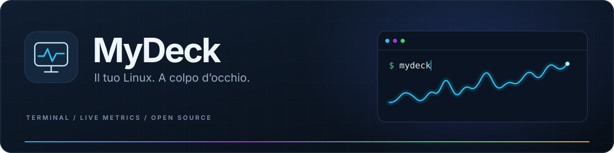

<p align="center">
  
</p>

<p align="center"><strong>Una dashboard Linux in tempo reale. Tutto nel tuo terminale.</strong></p>

<p align="center">
  
  
  
  <a href="LICENSE"></a>
</p>

<p align="center">
  <a href="#installazione">Installazione</a> ·
  <a href="#otto-viste-un-solo-comando">Funzionalità</a> ·
  <a href="#controlli">Controlli</a> ·
  <a href="#personalizza-la-tua-dashboard">Personalizzazione</a> ·
  <a href="CONTRIBUTING.md">Contribuisci</a>
</p>

---

## Il tuo sistema, senza cambiare finestra

CPU sotto carico, memoria che sale, traffico di rete o spazio in esaurimento: **MyDeck** riunisce le informazioni del tuo ambiente Linux in un’interfaccia da terminale, navigabile con tastiera e mouse.

Apri il terminale, scrivi `mydeck` e tieni d’occhio quello che conta. Le schede dell’Overview affiancano grafici, processi, filesystem e temperature; il menu laterale ti porta ai dettagli.

| Grafici che scorrono | Le risorse, insieme | Il terminale al centro |
| :--- | :--- | :--- |
| Linee fini, indicatore luminoso e animazioni fino a **20 FPS**. | **Otto sezioni** per passare dalla panoramica ai dettagli. | Navigazione da tastiera, ricerca, mouse e layout adattivo. |
| Campioni ogni **0,5 secondi**, zoom su **15 / 30 / 60 secondi**. | Processi ordinabili, traffico RX/TX e sensori hardware. | Python e la sua libreria standard. Dati locali, in sola lettura. |

## Installazione

Scarica o clona questa repository, poi apri un terminale nella cartella del progetto:

```bash
bash install.sh
mydeck
```

L’installer crea il comando in `~/.local/bin`, senza richiedere `sudo`. Se la directory non è nel tuo `PATH`, stampa la riga da aggiungere al profilo della shell. Per scegliere un’altra directory, imposta `XDG_BIN_HOME` prima dell’installazione.

> **Requisiti:** Linux, Python **3.10+** con `curses` e un terminale UTF-8. Bash serve per l’installer. `systemctl` e `ip` aggiungono rispettivamente i dati dei servizi e gli indirizzi IP, quando disponibili.

<details>
<summary><strong>Provalo senza installare il comando</strong></summary>

```bash
python3 -m mydeck
```

In alternativa, abilita `mydeck` soltanto nella sessione Bash corrente:

```bash
source ./activate
mydeck
```

</details>

<details>
<summary><strong>Aggiornamento e rimozione</strong></summary>

Se hai clonato la repository, aggiorna i sorgenti con `git pull` e riapri MyDeck. Il comando installato è un collegamento ai file del progetto: mantieni la cartella nella sua posizione.

Per rimuovere il comando installato:

```bash
unlink "${XDG_BIN_HOME:-$HOME/.local/bin}/mydeck"
```

La cartella del progetto rimane disponibile. Se la sposti, rimuovi il vecchio collegamento e riesegui `bash install.sh` dalla nuova posizione.

</details>

## Otto viste, un solo comando

| Tasto | Vista | Cosa trovi |
| :---: | :--- | :--- |
| `1` | **Overview** | Schede CPU, memoria, disco e rete; processi, filesystem e temperature affiancati. |
| `2` | **Processes** | PID, utente, CPU, RAM, stato e nome. Ricerca e ordinamento per trovare subito un processo. |
| `3` | **Performance** | Grafici CPU e memoria, utilizzo dei singoli core, swap e velocità di lettura e scrittura dei dischi. |
| `4` | **Storage** | Dispositivi, filesystem montati, occupazione, spazio libero e barre di utilizzo. |
| `5` | **Networks** | Interfacce, stato, IP, MAC, download, upload, totali ed errori. |
| `6` | **Sensors** | Temperature, ventole, tensioni, potenza e limiti esposti dall’hardware. |
| `7` | **Services** | Servizi systemd caricati, descrizione e stato; i servizi in errore compaiono per primi. |
| `8` | **Applications** | Catalogo delle applicazioni desktop registrate nelle directory XDG. |

## Un’interfaccia che segue il sistema

La palette combina **blu notte**, selezione **blu-viola** e accenti dedicati alle risorse: **ciano** per la CPU, **viola** per la memoria, **verde** per il disco e **ambra** per la rete.

I grafici usano caratteri Braille, con **2 × 4 punti per cella**, per disegnare linee più definite. La timeline scorre continuamente e le due serie di rete mantengono colori distinti. Con `t` cambi la finestra temporale; con `Spazio` congeli la visualizzazione per leggere un picco.

Per vedere la disposizione completa, usa una finestra di almeno **132 colonne × 40 righe**, con supporto a 256 colori. MyDeck funziona a partire da **70 × 16**: i pannelli si ridispongono, il contenuto si può scorrere e sotto le 94 colonne la barra laterale lascia spazio ai dati.

## Controlli

| Tasto | Azione |
| :--- | :--- |
| `1`–`8` | Apri una sezione direttamente. |
| `↑` / `↓`, `Tab` / `Shift+Tab` | Vai alla sezione precedente o successiva. |
| `←` / `→` | Chiudi o espandi il menu laterale. |
| `m` | Mostra o nasconde la barra laterale. |
| `j` / `k` | Scorri il contenuto di una riga. |
| `PgUp` / `PgDn`, `Home` / `End` | Scorri una pagina o raggiungi l’inizio e la fine. |
| `/`, poi `Invio` | Cerca nelle liste e conferma il filtro. |
| `Esc` | Cancella il filtro o chiudi l’aiuto. |
| `s` | Ordina i processi per CPU, RAM, PID o nome, in Overview e Processes. |
| `t` | Alterna lo zoom dei grafici tra 15, 30 e 60 secondi. |
| `Spazio` | Metti in pausa o riprendi la visualizzazione. |
| `r` | Richiedi un nuovo campione. |
| `h` / `?` | Apri o chiudi l’aiuto. |
| `q` / `Ctrl+C` | Esci. |

**Preferisci il mouse?** Clicca sulle sezioni, sul titolo del menu per espanderlo e sui collegamenti `View all` per aprire i dettagli. Clic su `Real-time` per mettere in pausa; la rotella scorre il contenuto sui terminali compatibili.

## Personalizza la tua dashboard

### Icone

I simboli Unicode sono attivi di default. Per icone più dettagliate e loghi dei processi riconosciuti, seleziona un **Nerd Font** nelle preferenze del terminale e avvia:

```bash
mydeck --icons nerd
```

Per mantenere questa scelta, aggiungi al profilo della shell:

```bash
export MYDECK_ICONS=nerd
```

Puoi tornare ai simboli standard con `mydeck --icons unicode`.

### Frequenza di aggiornamento

Il campionamento predefinito è di mezzo secondo. Puoi scegliere un intervallo tra **0,25 e 60 secondi**:

```bash
mydeck --interval 2
```

Le animazioni e il campionamento sono separati: il movimento dei grafici rimane fluido anche con aggiornamenti meno frequenti.

### Un campione in JSON

Per leggere i dati senza aprire l’interfaccia interattiva:

```bash
mydeck --once
mydeck --once > snapshot.json
```

MyDeck raccoglie due campioni per calcolare le velocità, stampa il secondo in JSON e termina. Tutte le opzioni sono disponibili con `mydeck --help`.

## Da dove arrivano i dati

MyDeck legge direttamente **`/proc`**, **`/sys`** e i file **`.desktop`** del sistema. La raccolta rimane locale e in sola lettura. Non serve un server, un account o un browser.

| Dati | Aggiornamento |
| :--- | :--- |
| CPU, memoria, processi, storage, traffico e sensori | Ogni **0,5 s** di default; configurabile. |
| Servizi, catalogo applicazioni e indirizzi IP | Ogni **15 s** circa. |
| Visualizzazione dei grafici | Fino a **20 FPS** in Overview e Performance. |

<details>
<summary><strong>Come leggere le metriche</strong></summary>

- **CPU:** il totale è normalizzato sull’intera macchina. Per un processo, 100% corrisponde a un core e il valore può superare il 100%.
- **Frequenza CPU:** media delle frequenze disponibili in `/proc/cpuinfo`.
- **RAM:** memoria totale meno memoria disponibile.
- **Rete:** velocità calcolate tra due campioni; contatori totali dall’avvio dell’interfaccia. L’Overview esclude il loopback.
- **Storage:** mount virtuali e duplicati per dispositivo sono esclusi.
- **Sensori:** compaiono quelli leggibili esposti dal kernel. Le etichette CPU, GPU e System vengono usate per i sensori riconosciuti.
- **Applications:** elenca le applicazioni desktop, non tutti i pacchetti installati.

La cronologia conserva fino a 240 campioni. I grafici si riempiono durante la sessione: prima dell’avvio non vengono inventati dati. Le linee interpolano soltanto tra misure reali, con un ritardo di presentazione massimo di un secondo. La pausa congela la schermata mentre la raccolta continua in background.

</details>

<details>
<summary><strong>Se qualche dato non compare</strong></summary>

| Situazione | Cosa controllare |
| :--- | :--- |
| Services non disponibile | systemd deve essere attivo e accessibile. È normale che non lo sia in alcuni container. |
| Indirizzi IP mancanti | Il comando `ip` deve essere disponibile. I contatori del traffico vengono letti da `/proc/net/dev`. |
| Nessun sensore | Hardware, driver e permessi devono esporre sensori leggibili in `/sys`. |
| Icone vuote o quadratini | Seleziona un Nerd Font oppure usa `--icons unicode`. |
| Grafici inizialmente vuoti | Attendi i primi campioni: la cronologia parte all’avvio. |
| `mydeck` non trovato | Segui l’indicazione sul `PATH` stampata dall’installer, oppure usa `python3 -m mydeck` dalla cartella del progetto. |

La resa dipende dal terminale e dal font. Quando il terminale permette colori personalizzati, MyDeck applica la palette e ripristina quella originale all’uscita; altrimenti usa i colori indicizzati disponibili.

</details>

## Costruiamolo insieme

Hai trovato un sensore non riconosciuto, un problema di layout o un modo per migliorare MyDeck? Apri una issue o proponi una pull request.

La [guida ai contributi](CONTRIBUTING.md) descrive la struttura del progetto, lo sviluppo locale e le verifiche da eseguire. Per lanciare i test:

```bash
python3 -m unittest discover -s tests -v
```

Il [workflow GitHub Actions](.github/workflows/tests.yml) è configurato per eseguirli su Linux con Python 3.10–3.14, a ogni push e pull request.

## Licenza

Distribuito con [licenza MIT](LICENSE).

---

<p align="center"><strong>Il tuo terminale. Il tuo sistema. MyDeck.</strong></p>
